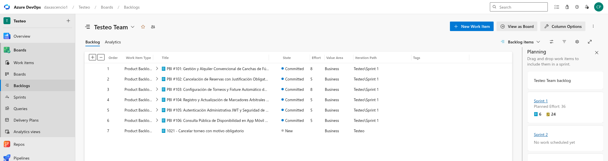
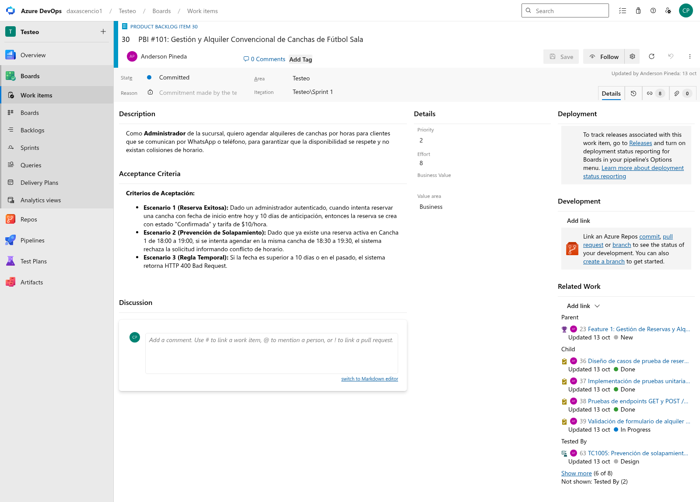
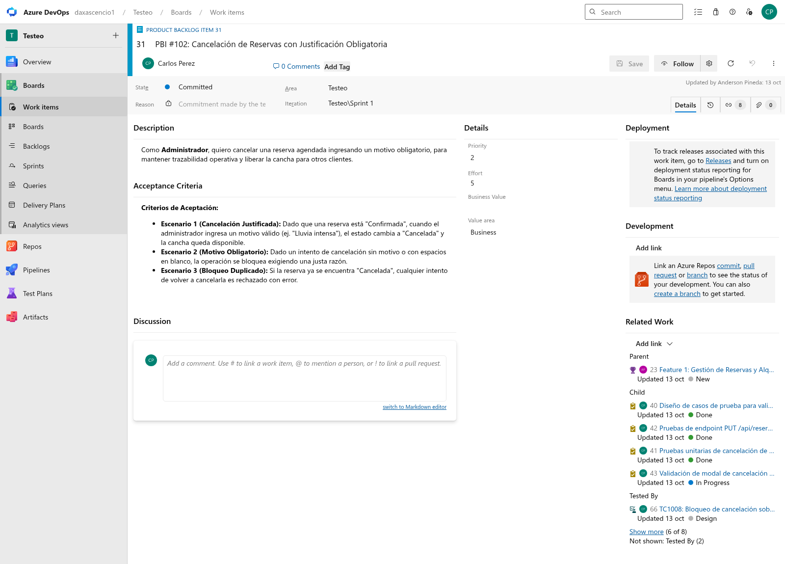
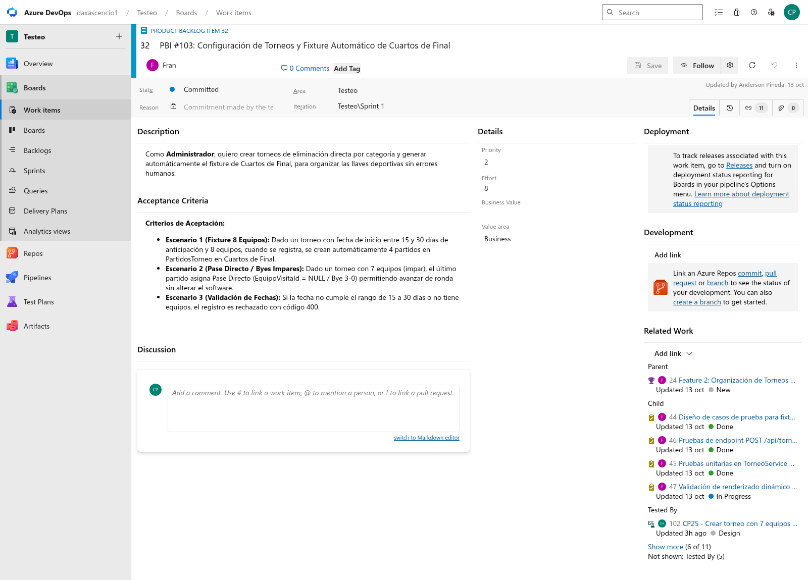
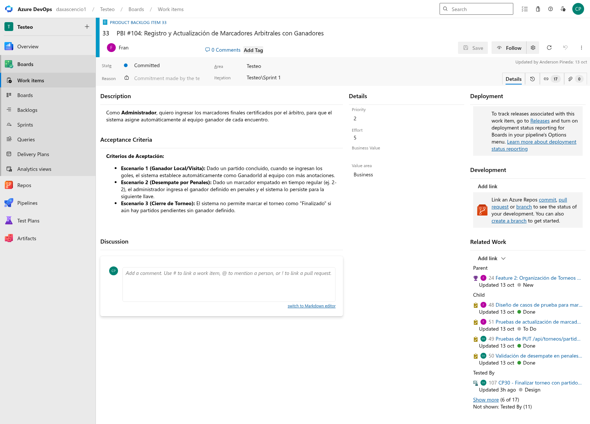
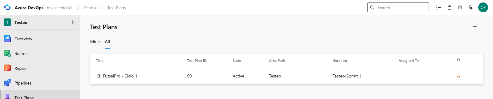
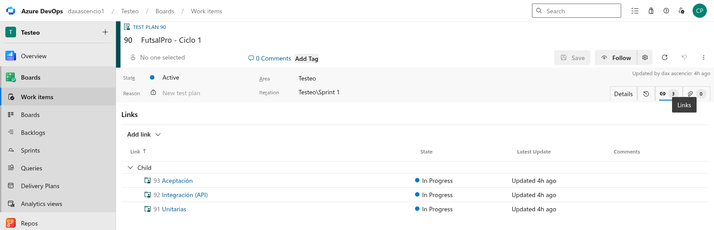
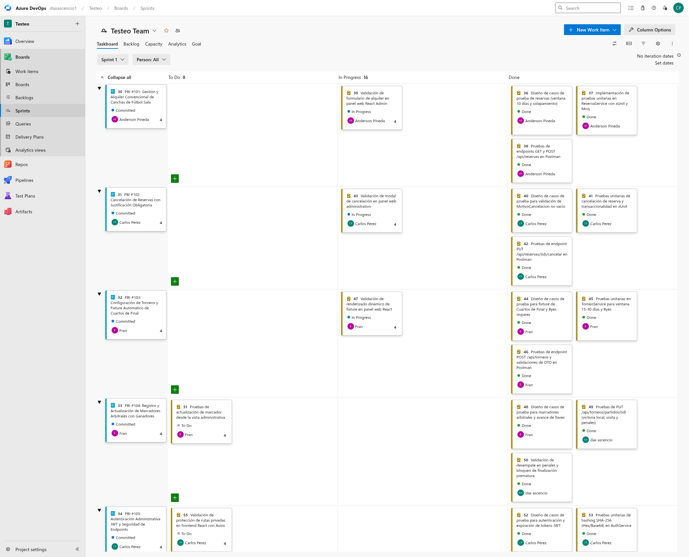

# Plan de Pruebas de Software — FutsalPro

**Sistema Integral de Gestión de Canchas y Torneos de Fútbol Sala**

| Campo | Detalle |
|---|---|
| Proyecto | FutsalPro – Sistema de Reservas y Torneos de Fútbol Sala |
| Módulo Académico | Testeo de Software |
| Versión | 1.0 |
| Estándar de referencia | ISO/IEC/IEEE 29119 (pruebas basadas en riesgos) |
| Metodología de gestión | Scrum – Sprint 1 en Azure DevOps |
| Líder de Pruebas | Anderson Rafael Pineda Flores |
| Equipo | Carlos Alexander Pérez Shupan, Anderson Rafael Pineda Flores, Dax Jerry Ascencio Guevara, Franklin Alberto Pérez Cerén |
| Estado | Aprobado para planificación y ejecución |

---

## 1. Introducción

FutsalPro es una plataforma deportiva para la administración de una sucursal única de fútbol sala: alquiler de canchas por horas y organización de torneos de eliminación directa con generación automática de llaves y sincronización en tiempo real.

El ecosistema se implementa bajo Clean Architecture distribuida en tres capas tecnológicas:

1. **Backend Web API** — ASP.NET Core 8 (.NET 8) y Entity Framework Core, desplegado en Render, con base de datos SQL Server en MonsterASP (`db70759`).
2. **Panel Web Administrativo** — React.js, Vite y Tailwind CSS para recepción y administración operativa.
3. **Aplicación Móvil de cliente/espectador** — React Native con Expo Dev Client, consulta pública de disponibilidad y cruces, con Deep Link hacia WhatsApp.

Este documento define la planificación de pruebas conforme a ISO/IEC/IEEE 29119, con enfoque basado en riesgos y distribución equitativa y trazable del trabajo entre los cuatro integrantes.

---

## 2. Alcance

### 2.1 Alcance funcional (qué SÍ se prueba)

| Módulo / Subsistema | Reglas de negocio y comportamiento a verificar | Riesgo | Responsable |
|---|---|---|---|
| Reservas convencionales | Alquiler por horas ($10/hora), ventana de 10 días, no retroactividad, solapamiento horario en la misma cancha y edición de datos. | Alto | Anderson Rafael Pineda Flores |
| Cancelación de reservas | Motivo obligatorio (no vacío), cambio a estado `Cancelada`, liberación de horarios y bloqueo de cancelaciones duplicadas. | Alto | Carlos Alexander Pérez Shupan |
| Torneos y fixture | Ventana de 15 a 30 días, fixture de Cuartos de Final (hasta 16 equipos) y Pase Directo (Bye 3-0) para llaves impares. | Alto | Franklin Alberto Pérez Cerén |
| Marcadores y resultados | Registro de marcadores arbitrales, ganador automático, desempate en penales, prohibición de goles negativos y bloqueo de cierre prematuro. | Alto | Franklin Pérez / Dax Ascencio |
| Seguridad y autenticación | Login (`/api/auth/login`), expiración JWT (8 horas), hash SHA-256 (Hex/Base64) y protección de endpoints administrativos. | Medio | Carlos Alexander Pérez Shupan |
| App móvil (espectador) | Consulta de disponibilidad de solo lectura sin login, llaves en vivo y botón flotante Deep Link a WhatsApp. | Medio | Dax Jerry Ascencio Guevara |
| Integridad de base de datos | Foreign Keys en SQL Server MonsterASP, persistencia transaccional y Seed Data (roles, estados, canchas). | Medio | Dax Ascencio / Anderson Pineda |
| Panel web administrativo | Vite + React 18, validación en cliente, modales de cancelación obligatoria y sincronización de estado. | Medio | Carlos Pérez / Anderson Pineda |

### 2.2 Fuera de alcance (qué NO se prueba)

- **Rendimiento extremo:** estrés masivo superior a 5,000 peticiones simultáneas por segundo.
- **Infraestructura de red:** pruebas de penetración e inyección profunda sobre la red física de MonsterASP y Render.
- **Pagos bancarios:** pasarelas de pago electrónico (las reservas se cobran presencialmente en recepción).
- **Incidencias en vivo:** registro detallado durante el partido (tarjetas, faltas); solo se prueba el marcador final oficial.
- **Partido final:** generación automática de la Final, gestionada operativamente como un alquiler convencional.
- **Sistemas obsoletos:** compatibilidad con navegadores antiguos (IE) o Android anterior a 8.0.

---

## 3. Objetivos de calidad y criterios de aceptación

| Nivel de riesgo | Módulos involucrados | Criterio de aceptación cuantitativo |
|---|---|---|
| Alto | Reservas, Cancelaciones, Torneos y Marcadores | 100% de casos aprobados y 0 defectos críticos o altos abiertos. |
| Medio | Seguridad JWT, Consulta móvil, Base de datos, Panel web | ≥ 90% de casos aprobados y 0 defectos críticos abiertos. |
| Bajo | Diseño estético secundario, textos informativos y enlaces estáticos | ≥ 85% de casos aprobados; se toleran defectos cosméticos menores. |

**Criterios de cierre y métricas**

| Criterio de calidad | Meta obligatoria |
|---|---|
| Cobertura de requisitos (regla de negocio con ≥ 1 caso) | 100% |
| Casos planificados y ejecutados | ≥ 95% |
| Casos aprobados en módulos de riesgo alto | 100% |
| Casos aprobados en módulos de riesgo medio | ≥ 90% |
| Defectos críticos y altos abiertos | 0 |
| Cobertura de código unitario en `Application` | ≥ 75% |

**Prioridad de cada prueba:** `Prioridad = Probabilidad de fallo × Impacto en el negocio`.

---

## 4. Roles y responsabilidades (100% de participación)

| Integrante | Rol especializado | Módulos y entregables | PBI |
|---|---|---|---|
| **Anderson Rafael Pineda Flores** | Líder de Pruebas (Test Manager) y Diseñador Senior | Plan de pruebas ISO 29119, Sprint 1 en Azure DevOps, casos de Reservas (ventana 10 días, $10/hora, solapamientos), informe final de cierre. | #101 |
| **Carlos Alexander Pérez Shupan** | Diseñador de Pruebas de Seguridad y Cancelaciones | Casos de Autenticación JWT, verificación SHA-256 y regla de cancelación con motivo obligatorio. Tests de `AuthService` y cancelaciones. | #102, #105 |
| **Franklin Alberto Pérez Cerén** | Diseñador de Pruebas y Automatizador de Torneos | Casos de Torneos y Fixture de Cuartos (15–30 días), Byes impares 3-0, marcadores arbitrales y ganador local/visita. Tests de `TorneoService` en xUnit. | #103, #104 |
| **Dax Jerry Ascencio Guevara** | Diseñador de Pruebas de App Móvil e Integración | Casos de App Móvil (solo lectura, fricción cero), Deep Link a WhatsApp, desempates en penales, cancelación justificada de torneos y persistencia relacional en SQL Server. | #104, Suite Móvil |

### 4.1 Distribución de casos por integrante

| Integrante | Aceptación (Excel) | API REST (Excel) | Unitarias (Excel) | PBI |
|---|---|---|---|---|
| Carlos Alexander Pérez Shupan | 1001, 1002, 1008, 1009, 1010 | CP01–CP04, CP15–CP17 | 2009–2012, 2026–2029 | #102, #105 |
| Anderson Rafael Pineda Flores | 1003–1007, 1020 | CP05–CP14 | 2001–2008 | #101 |
| Franklin Alberto Pérez Cerén | 1013–1018 | CP18–CP23 | 2013–2019 | #103, #104 |
| Dax Jerry Ascencio Guevara | 1011, 1012, 1019, 1021, 1022 | CP24–CP30 | 2020–2025, 2030 | #104, Suite Móvil |

---

## 5. Metodología y niveles de prueba

Ciclo formal basado en riesgos: análisis de riesgos → planificación → criterios de aceptación → diseño y ejecución priorizada → cierre y reporte con métricas.

**Técnicas de diseño aplicadas (ISO/IEC/IEEE 29119-4)**

| Técnica | Aplicación en FutsalPro |
|---|---|
| Partición de equivalencia | Fechas válidas (≤ 10 días) vs inválidas (> 10 días); goles positivos vs negativos. |
| Análisis de valores límite | Día 10 vs 11 (reservas); día 14 vs 15 y 30 vs 31 (torneos). |
| Tabla de decisión | Cancha libre + rango sin colisión + anticipación válida = reserva aprobada. |
| Transición de estados | Reserva: Pendiente → Confirmada → Cancelada; Torneo: Programado → Activo → Finalizado. |
| Pruebas de concurrencia | Dos administradores reservando el mismo bloque horario en la Cancha 1. |

**Niveles de prueba**

| Nivel | Objetivo | Alcance | Herramienta |
|---|---|---|---|
| Unitarias | Validar lógica de negocio aislada con repositorios simulados. | `ReservaService`, `TorneoService`, `AuthService` en `Application`. | .NET 8, xUnit 2.5, Moq 4.20 |
| Integración | Verificar comunicación entre capas (Controladores → Servicios → EF Core → BD). | Endpoints de Auth, Reservas y Torneos. | `WebApplicationFactory` + Postman |
| Sistema (E2E) | Validar flujos completos a través de las interfaces. | Panel Web Admin (React/Vite) y app React Native Expo. | Manual guiada, React Testing Library, Cypress |
| Aceptación | Confirmar que el sistema responde a las expectativas operativas. | Jornada real simulada: torneo de 7 equipos, Byes y cancelaciones. | Plantilla Excel de aceptación |

---

## 6. Clasificación de defectos

| Severidad | Definición | Ejemplo en FutsalPro | SLA de corrección |
|---|---|---|---|
| Crítica (Blocker) | Inutiliza el sistema, corrompe datos o permite solapamiento de reservas. | Dos reservas confirmadas colisionan; caída de la API en Render. | Inmediato (< 4 horas) |
| Alta (Major) | Falla una funcionalidad principal sin alternativa viable. | No se puede iniciar sesión con JWT; el fixture no genera cuartos. | 1–2 días hábiles |
| Media (Normal) | Funcionalidad afectada con procedimiento operativo alternativo. | El marcador se actualiza pero exige refrescar la pantalla. | Siguiente iteración |
| Baja (Minor) | Defecto cosmético o inconsistencia visual. | Etiqueta desalineada en el modal de cancelación. | Según disponibilidad |

---

## 7. Criterios de suspensión y reanudación

**Suspensión inmediata cuando:**

- Falle la compilación de `GestionTorneos.sln` o la Web API no levante con `dotnet run`.
- No haya conexión con SQL Server en MonsterASP (`db70759`).
- Falle `/api/auth/login` e impida obtener tokens JWT para las pruebas autenticadas.
- Exista un defecto crítico que permita duplicidad de reservas en la misma cancha.
- Se bloquee más del 30% de los casos de prueba de la iteración.

**Reanudación cuando:**

- Se entregue un build estable verificado contra la BD MonsterASP con DBeaver.
- El defecto bloqueante esté subsanado y validado con Smoke Test.
- El Líder de Pruebas apruebe formalmente la reanudación.

---

## 8. Entregables

| # | Entregable | Responsable líder | Semana | Formato |
|---|---|---|---|---|
| 1 | Plan de Pruebas del Software (ISO 29119) | Anderson Rafael Pineda Flores | 1 | Word (.docx) |
| 2 | Matriz de Análisis de Riesgos | Anderson Rafael Pineda Flores | 1 | Plan de Pruebas |
| 3 | PBIs y Test Cases en Azure DevOps | Equipo completo | 1 | Azure Boards |
| 4 | Plantilla de Casos de Aceptación | Franklin Pérez / Dax Ascencio | 2 | Excel (.xlsx) |
| 5 | Plantilla de Casos de API REST | Anderson Pineda / Carlos Pérez | 2 | Excel (.xlsx) |
| 6 | Plantilla de Casos Unitarios | Franklin Pérez / Carlos Pérez | 2 | Excel (.xlsx) |
| 7 | Colección de Pruebas de API Automatizadas | Anderson Pineda / Dax Ascencio | 3–4 | Postman v2.1 JSON |
| 8 | Scripts Automatizados Unitarios | Franklin Pérez / Carlos Pérez | 3–4 | C# .NET 8 (xUnit + Moq) |
| 9 | Reporte de Defectos e Incidencias | Equipo completo | 3–4 | Azure DevOps Bugs |
| 10 | Informe Final de Resultados | Anderson Rafael Pineda Flores | 5 | Documento de cierre |

---

## 9. Herramientas y entorno

**Herramientas de prueba**

| Herramienta | Propósito | Responsable |
|---|---|---|
| xUnit 2.5 + Moq 4.20 | Pruebas unitarias en .NET 8; simulación de `DbContext` y servicios. | Franklin Pérez / Carlos Pérez |
| Postman / REST Client | Ejecución automatizada de casos de API REST. | Anderson Pineda / Dax Ascencio |
| Swagger UI (OpenAPI) | Inspección de contratos de Auth, Reservas y Torneos. | Anderson Pineda / Franklin Pérez |
| Azure DevOps Boards & Test Plans | Planificación, PBIs, diseño y ejecución con trazabilidad. | Equipo completo |
| DBeaver Community | Inspección y validación de SQL Server MonsterASP. | Dax Ascencio / Anderson Pineda |
| React Testing Library / Vite | Pruebas de componentes del panel web. | Carlos Pérez / Anderson Pineda |
| Expo Dev Client / Expo Go | Pruebas en dispositivos móviles reales. | Dax Ascencio / Franklin Pérez |

**Entorno de prueba**

| Componente | Especificación |
|---|---|
| Sistema operativo | Windows 11 Pro / Ubuntu 22.04 LTS |
| Runtime backend | .NET 8.0 SDK (ASP.NET Core 8 Web API, Clean Architecture) |
| Base de datos | Microsoft SQL Server 2022 en MonsterASP.NET (`db70759`) |
| Backend en nube | Render — `https://futsal-k08n.onrender.com` |
| Backend local | `http://localhost:5000` / `https://localhost:5001` |
| Frontend web | React 18, Vite 5, Tailwind CSS, Axios (`http://localhost:5173`) |
| Frontend móvil | React Native 0.74, Expo SDK 51 (`http://localhost:8081`) |
| Navegadores | Chrome 120+, Edge 120+, Firefox 120+ |
| Dispositivos | Android 11+ físico y simulador iOS con Expo Go |

---

## 10. Integración continua

El repositorio incluye `azure-pipelines.yml`, que en cada cambio sobre la rama `develop`:

1. Restaura y compila `GestionTorneos.sln` con .NET 8.
2. Ejecuta `UnitTests` e `IntegrationTests` con cobertura (`coverlet`) y resultados TRX.
3. Publica resultados de pruebas y reporte de cobertura en Azure DevOps.

Las pruebas **no dependen de internet ni de un SQL Server real**: las de integración usan `WebApplicationFactory` (`CustomWebApplicationFactory`) con proveedor InMemory, y las unitarias usan mocks. El archivo `azure-pipelines.yml` no contiene secretos: las cadenas de conexión y tokens deben inyectarse como variables de pipeline o secretos de la biblioteca.

---

## 11. Evidencias en Azure DevOps

Capturas obtenidas de la organización `daxascencio1`, proyecto `Testeo`, equipo `Testeo Team` (22/10/2026).

### 11.1 Product Backlog Items del Sprint 1

### 11.2 PBI #101 — Reservas

### 11.3 PBI #102 — Cancelación de reservas

### 11.4 PBI #103 — Torneos y fixture

### 11.5 PBI #104 — Marcadores y resultados

### 11.6 Plan de pruebas y suites

### 11.7 Taskboard del Sprint 1

